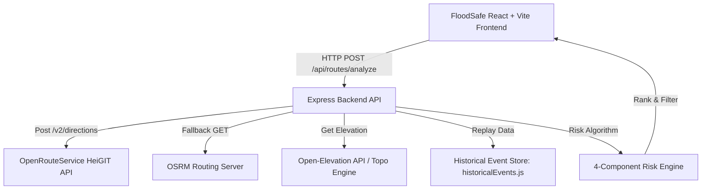

# FloodSafe System Architecture & Technical Specification

## Overview
FloodSafe is an environmental safety platform that evaluates road waterlogging risks by analyzing rainfall forecasts, terrain topography, elevation profiles, historical flood events, and smart alternative route recommendations.

"Know the risk before you travel."

---

## Architecture Diagram

---

## Key Components

### 1. Provider-Agnostic Routing Layer (`routing.service.js`)
- Attempts **OpenRouteService** (HeiGIT GeoJSON API) first using `OPENROUTESERVICE_API_KEY`.
- Requests up to 3 genuine alternative driving routes (`driving-car`).
- Seamlessly falls back to **OSRM** if OpenRouteService is unavailable or unconfigured.

### 2. 4-Component Risk Evaluation Engine (`routeRisk.service.js`)
FloodSafe evaluates flood risk across four weighted components:
- **Rainfall Intensity (30%)**: Calculates precipitation risk score based on Safdarjung/Ridge station data or live Open-Meteo forecast.
- **Historical Waterlogging (35%)**: Evaluates proximity of route points to source-backed historical flood coordinates.
- **Rainfall Similarity (20%)**: Compares current/historical rainfall intensity against historical baseline event intensity (July 8, 2023 heavy rain event = 98.7mm).
- **Terrain Topography (15%)**: Evaluates relative elevation profiles to detect low-lying route segments prone to pooling.

### 3. Source-Backed Historical Hotspot Matcher
- **Geospatial Hotspot Matching**: Evaluates route coordinate geometry against verified, source-backed historical waterlogging coordinates.
- **Minto Bridge Hotspot**:
  - Latitude: `28.637179`
  - Longitude: `77.222333`
  - Coordinate Source: *Delhi Government PWD Document* (`appendix_vii.pdf`)
  - Verification: Routes passing within `<= 250m` trigger a peak localized hotspot signal score of `100` and record exact minimum distance (`91m`).
